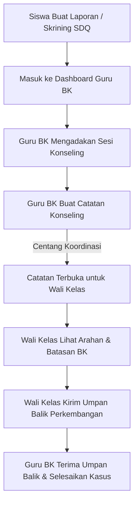

# RANGKUMAN KOMPREHENSIF PROJECT CURHATAMAN
> **Petunjuk**: Dokumen ini dapat Anda *copy-paste* langsung ke ChatGPT sebagai konteks penuh project agar ChatGPT langsung memahami seluruh arsitektur, fitur, dan skema database CurhatAman tanpa perlu dijelaskan dari awal.

---

## 1. IDENTITAS & DESKRIPSI PROJECT
* **Nama Project**: **CurhatAman**
* **Deskripsi Singkat**: Platform web berbasis sekolah yang dirancang untuk mendukung kesehatan mental dan keselamatan siswa melalui sistem pelaporan kasus rahasia, skrining awal SDQ (*Strengths and Difficulties Questionnaire*), serta koordinasi pendampingan terstruktur antara Guru BK, Wali Kelas, dan Admin Sekolah.
* **Tech Stack**:
  * **Framework**: Laravel 11 (PHP 8.2+)
  * **Database**: MySQL / MariaDB
  * **Front-End**: HTML5, Blade Templating, Bootstrap 5.3, Bootstrap Icons (bi-*), Vanilla CSS custom design system (Teal Theme `#0f8a83`)
  * **Authentication**: Custom Laravel Auth with Password Reset Tokens & Notification System

---

## 2. SPESIFIKASI PERAN PENGGUNA (MULTI-ROLE 5 LEVEL)

### A. SISWA (STUDENT)
1. **Registrasi & Profil**: Pendaftaran akun mandiri dengan verifikasi NIS, Kelas, Tahun Masuk, dan Nomor WhatsApp aktif.
2. **Pelaporan Kasus Rahasia**: Mengirim laporan masalah/insiden dengan opsi anonimitas atau identitas terbuka, melampirkan bukti gambar/dokumen.
3. **Skrining SDQ Mandiri**: Mengisi kuesioner skrining kesehatan mental berkala berdasarkan paket skrining aktif.
4. **Permintaan Bantuan Konseling**: Mengajukan permohonan sesi konseling langsung ke Guru BK.
5. **Bantuan & Notifikasi**: Menerima pembaruan status laporan dan jadwal konseling.

### B. GURU BK (COUNSELING TEACHER)
1. **Dashboard & Statistik**: Pantauan kasus aktif, tren kesehatan mental siswa, dan jumlah skrining.
2. **Manajemen Laporan & Konseling**: Memproses laporan masuk, menentukan tindakan lanjutan, membuat jadwal konseling, dan mencatat hasil sesi konseling.
3. **Catatan Konseling Terkoordinasi (Koordinasi Wali Kelas)**:
   * Menandai catatan konseling tertentu agar dapat dilihat oleh Wali Kelas (`is_shared_wali_kelas`).
   * Memberikan **📌 Arahan & Batasan Tindakan Spesifik** agar Wali Kelas paham apa yang boleh dan tidak boleh dilakukan terhadap siswa di kelas.
4. **Manajemen Skrining SDQ**: Mengatur paket pertanyaan skrining, menganalisis hasil skrining siswa (Normal, Ambang, Abnormal), serta menetapkan Guru BK penanggung jawab.
5. **Mitra Rujukan**: Mengatur alur rujukan kasus berat ke lembaga/instansi eksternal (psikolog, rumah sakit, dll).

### C. WALI KELAS (HOMEROOM TEACHER)
1. **Ringkasan Kelas**: Memantau daftar siswa di kelas binaannya.
2. **Pendampingan & Koordinasi Siswa**: 
   * Melihat daftar siswa di kelas yang sedang dalam pendampingan BK/memiliki hasil skrining SDQ (Ambang/Abnormal).
   * Membaca **Arahan & Batasan Tindakan dari Guru BK** tanpa mengakses kerahasiaan rincian isi curhat sensitif.
   * **Mengirim Umpan Balik Wali Kelas**: Memberikan catatan perkembangan perilaku siswa di kelas untuk ditindaklanjuti Guru BK.
3. **Partisipasi Skrining**: Memantau kelengkapan siswa kelas dalam mengisi skrining SDQ.

### D. ADMIN SEKOLAH (SCHOOL ADMIN)
1. **Manajemen Pengguna**: Mengelola data pengguna (Siswa, Guru BK, Wali Kelas, Admin) termasuk reset password manual.
2. **Pengaturan Sistem & Identitas Sekolah**: Pengaturan nama sekolah, logo, semester aktif, dan informasi identitas.
3. **Manajemen Master Data**: Pengelolaan Master Kelas, Kategori Kasus, dan Mitra Rujukan.
4. **Audit Log & Eskalasi Kasus**: Memantau aktivitas sistem dan menangani eskalasi/kasus yang membutuhkan penanganan administratif.

### E. GUEST / LANDING PAGE
1. **Halaman Beranda Publik**: Informasi platform, penjelasan fitur, alur pelaporan, dan FAQ.
2. **Portal Autentikasi**: Halaman Masuk (*Login*), Daftar (*Register*), Lupa Kata Sandi (*Forgot Password*), dan Setel Ulang Kata Sandi (*Reset Password*).

---

## 3. STRUKTUR TABEL DATABASE UTAMA

1. `users`: `id`, `name`, `email`, `password`, `role` (student, guru_bk, wali_kelas, admin), `is_active`, `profile_photo_path`, `remember_token`, `created_at`, `updated_at`.
2. `siswa`: `id`, `user_id`, `kelas_id`, `nis`, `tahun_masuk`, `whatsapp_number`, `whatsapp_consent`, `status_kondisi`.
3. `kelas`: `id`, `nama_kelas`, `tingkat`, `wali_kelas_user_id`.
4. `kategori_kasus`: `id`, `nama_kategori`, `deskripsi`, `tingkat_keparahan`.
5. `laporan_kasus`: `id`, `kode_laporan`, `siswa_user_id`, `kategori_kasus_id`, `deskripsi_kejadian`, `is_anonim`, `status_laporan`, `guru_bk_user_id`.
6. `catatan_konseling`: `id`, `laporan_kasus_id`, `guru_bk_user_id`, `tanggal_konseling`, `ringkasan_masalah`, `rekomendasi_tindakan`, `is_shared_wali_kelas`, `arahan_wali_kelas`, `umpan_balik_wali_kelas`, `tgl_umpan_balik_wali_kelas`.
7. `skrining_siswa`: `id`, `siswa_user_id`, `paket_skrining_id`, `assigned_bk_user_id`, `skor_sdq`, `kategori_sdq` (Normal, Ambang, Abnormal), `status_tindak_lanjut`.
8. `paket_skrining`: `id`, `nama_paket`, `deskripsi`, `is_aktif`.
9. `pertanyaan_skrining`: `id`, `paket_skrining_id`, `teks_pertanyaan`, `kategori_faktor`.
10. `rujukan`: `id`, `laporan_kasus_id`, `mitra_rujukan_id`, `alasan_rujukan`, `status_rujukan`.
11. `pengaturan_sistems`: `id`, `nama_sekolah`, `logo_sekolah`, `semester_aktif`, `tahun_ajaran`.
12. `password_reset_tokens`: `email`, `token`, `created_at`.

---

## 4. ALUR KERJA UTAMA (BUSINESS WORKFLOW)

---

## 5. INSTRUKSI PENGGUNAAN PROMPT UNTUK CHATGPT

> **Copy pesan di bawah ini ke ChatGPT saat Anda memulai percakapan baru:**
>
> *"Halo ChatGPT! Saya sedang menyelesaikan Laporan Akhir & Timeline Kegiatan untuk project sistem web bernama **CurhatAman** (Sistem Pelaporan, Skrining SDQ, dan Koordinasi Pendampingan BK & Wali Kelas berbasis Laravel 11). Di atas adalah rangkuman struktur sistem, teknologi, 5 peran pengguna, skema database, dan fitur-fiturnya. Mohon bantu saya menyusun [Sebutkan bagian laporan yang ingin dibuat, misal: Bab 3 Metodologi & Timeline / Bab 4 Hasil & Pembahasan / Laporan Manajemen Project] berdasarkan data teknis CurhatAman di atas."*
